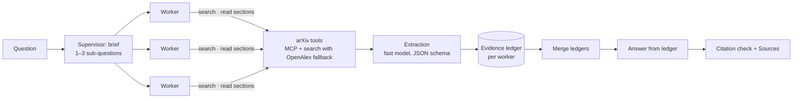

# Agentic Research Assistant

**Grounded, progressive research over arXiv**, built from scratch in Python with no agent framework. Designed to go from a broad overview to a single paper:

1. **Trust-ranked overviews:** retrieval ranked by trust signals (citations, venue, recency, cross-source corroboration) produces an overview where every claim cites a source.
2. **Guided paper walkthroughs:** for a selected paper, it extracts the research flow (problem → method → experiments → findings → limitations) and guides the reader through it one stage at a time.

| Built | Planned |
|---|---|
| Agent runtime · MCP paper sources · evidence ledger with checked citations · multi-agent research · eval harness with an LLM judge | Trust-ranked overviews · guided paper walkthroughs |

**Design rule:** the model decides what to read and interprets evidence; the harness owns state, provenance, and stopping.

## Architecture



Each worker is the same ReAct agent, researching one sub-question in its own context. `ask --single` runs one agent on the whole question.

## Highlights

**Agent runtime, no framework**
- Bounded ReAct loop with step, tool-call, and time budgets; malformed tool calls return errors the model corrects.
- Infrastructure failures handled in code: retries with backoff, retried empty model replies, and an OpenAlex fallback when arXiv search is rate-limited.
- JSONL trace per run: tokens, latency, tool calls, and what the context kept vs. what each tool returned.

**Sources as configuration (MCP)**
- A generic MCP client wraps any server's tools behind an allowlist; adding a source is a config entry.
- Pinned arguments and description overrides keep the model within each tool's intended use.

**Context engineering**
- Papers are read section by section; each read is distilled into an **evidence ledger** of findings with harness-attached provenance and links that support, contradict, or qualify earlier findings.
- Raw text is replaced in history by a one-line record; current notes are re-rendered into each call instead of accumulating.
- Answers are written from the ledger only, cite findings by number, and are checked against the ledger before a Sources list is appended.

**Multi-agent research**
- A supervisor runs a fixed workflow in code (brief → parallel workers → merge → answer); workers do the open-ended research in isolated contexts.
- Worker ledgers are merged with unique IDs, so one answer can cite evidence from every worker; a failed worker is skipped, not fatal.

## Results

An eval harness runs 8 research questions (5 broad, 3 narrow) through both modes, scores them from their traces, and compares the answers with an LLM judge (Gemini 2.5 Flash, a different model family from the agent; every pair is judged in both orders and a win counts only when both agree).

| | Multi-agent vs. single agent |
|---|---|
| Sources read | **~2.4× more** (~2.9× on broad questions; 3–6 papers vs. 1–2) |
| Answer completeness (judge) | multi favored or tied on every question; single never won |
| Answer specificity (judge) | multi favored on every question |
| Faithfulness (judge: claims supported by their cited findings) | 95–99% in both modes |
| Cost | ~2.7× tokens, ~1.8× wall-clock time |

The advantage held in a check where the single agent was given the team's full tool budget: it stopped on its own after 6–14 tool calls, and multi still read ~2.7× more sources. Context compression cut peak prompt size by ~26% in an early single-run measurement.

Full tables: [`eval_results_with_scores.md`](src/research_assistant/evals/eval_results_with_scores.md).

## Quick start

```bash
cp .env.example .env    # add an OpenRouter API key
uv sync
uv run ask "How do retrieval-augmented agents handle long documents?"           # multi-agent
uv run ask --single "What does the ReAct paper (arXiv:2210.03629) show?"        # one agent
```

Models are set in `.env`: `MODEL_ID` (research), `EXTRACTION_MODEL_ID` (findings), and `JUDGE_MODEL_ID` (eval judge). A full eval costs about $0.40 with the defaults in `.env.example`.

**Reproduce the eval:**

```bash
uv run python -m research_assistant.evals.run_evals      # both modes per question; resumable
uv run python -m research_assistant.evals.score_evals    # scores, judges, and writes the report
```

## Roadmap

- **Trust-ranked overviews** and **guided paper walkthroughs**, the two goals in the design above.
- A shared research budget the supervisor splits across workers, and an equal-budget comparison built on it.
- A larger question set, and offline tests for the eval harness.

## Credits

Ideas from [PaperQA2](https://github.com/future-house/paper-qa) and Anthropic's [context engineering post](https://www.anthropic.com/engineering/effective-context-engineering-for-ai-agents); paper reading via [arxiv-mcp-server](https://github.com/blazickjp/arxiv-mcp-server); fallback search via [OpenAlex](https://openalex.org). Thank you to arXiv for use of its open access interoperability. MIT License.
