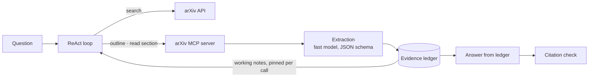

# Agentic Research Assistant

**Grounded, progressive research over arXiv**, built from scratch in Python with no agent framework. Designed as a two-tier pipeline:

1. **Overview:** trust-ranked retrieval (citation, venue, recency, cross-source corroboration) produces an overview where every claim cites a source.
2. **Deep dive:** for a selected paper, it extracts the research flow (problem → method → experiments → findings → limitations) and guides the user through it with scaffolded reading.

| Built | In progress | Planned |
|---|---|---|
| Agent runtime · MCP paper sources · evidence ledger with checked citations | Multi-agent research | Tier 1 trust ranking · Tier 2 scaffolded deep dive |

**Design rule:** the model decides what to read and interprets evidence; the harness owns state, provenance, and stopping.

## Architecture



## Highlights

**Agent runtime, no framework**
- Tool registry that never crashes a run: malformed calls return errors the model corrects.
- Infrastructure failures retried in code; step, tool-call, and time budgets share one exit path.
- JSONL trace per run: tokens, latency, tool calls, and what the context kept vs. what the tool returned.

**Sources as configuration (MCP)**
- Generic MCP client wraps any server's tools behind an allowlist; adding a source is a config entry.
- Pinned arguments and description overrides, added after the model bypassed a size limit through a second argument.

**Context engineering**
- Papers are read section by section; each read is distilled into an **evidence ledger**: findings with harness-attached provenance, links that support, contradict, or qualify earlier findings, and open questions.
- Raw text is replaced in history by a one-line record; current notes are re-rendered into each call instead of accumulating.
- Extraction runs on a separate fast model with schema-constrained output and a safe fallback; answers are written from the ledger only.

## Results (preliminary)

| Measure | Result |
|---|---|
| Peak prompt size | **~26% smaller** with the ledger (9.5k vs. ~12.8k estimated tokens, single run) |
| Extraction latency | **~5s** on a small model vs. ~80s on the main reasoning model (~11k hidden reasoning tokens) |

A 10–15 question evaluation (single vs. multi-agent, citation validity, coverage) is in progress.

## Example

```
Q: How do recent world-model methods compare on benchmarks?
[1] On Crafter, vanilla PPO remains near the random-policy floor while EWM consistently outperforms LaRe. (arXiv:2610.13504 §5)
[2] The gap between EWM and LaRe widens with horizon length, reaching ~2× at L=1000. (arXiv:2610.13504 §5)
In context, the section's text became: "arXiv:2610.13504 §5 → added [1] · added [2] · … Saved to notes; full text not kept."
```

## Quick start

```bash
cp .env.example .env    # add an OpenRouter API key
uv sync
uv run ask "How do retrieval-augmented agents handle long documents?"
```